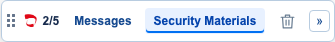

# KaTe · Pins

Keep a working SAP Cloud Integration view on the left and open saved views on
the right. Up to five pins are saved separately for each tenant.

Pin-list screenshot from the browser test fixture with example view names.

## Requirements

- Google Chrome 155 or later with native Split View available.
- CPI Helper enabled on the SAP Cloud Integration tenant.
- Enable **KaTe · Pins** in **Plugins → Manage plugins**.

The plugin checks the split APIs before displaying its controls. On browsers
without these APIs, Pins stays inactive and the existing CPI Helper UI remains
available. Pins is intended for Google Chrome 155+. No Pins support is claimed
for Microsoft Edge or Firefox. Checks on those browsers concern compatibility
of the shared CPI Helper extension, not a Pins port or support commitment.

## Use

1. Open the SAP view you want to save in the left tab.
2. Select **Pin current left SAP view** on the small control at the right edge.
   The first pin opens a native split with a second SAP tab.
3. Continue working on the left. Select a pin in the right-hand pin list to
   switch the right view.
4. Right-click a pin to **Rename** or **Remove pin**. Keyboard users can focus
   the pin and press **Shift+F10**, use arrow keys and confirm with Enter.
   Dragging a pin onto the trash also removes it; dropping elsewhere cancels.
5. Drag the dotted handle to move the pin list, or focus it and use arrow keys.
   Its position is remembered per tenant. The chevron minimizes the list.
6. **Close split** separates the tabs. **Open split** reuses the right tab when
   it is still available, or creates one when needed.

Removing a pin does not close its SAP tab. Closing a tab does not delete its
saved pin. Saved pins remain after restarting the browser; right-hand tabs are
opened only when a pin is selected.

The image shows the actual plugin UI rendered with synthetic pin names in the
browser test fixture. It contains no tenant or user data.

## Navigation and limits

All pins share one right-hand tab. Switching pins preserves the existing split
and divider position. Closing and reopening a split normally starts at 50/50;
Chrome does not expose divider-position restoration through the APIs used here.

When a matching browser-history entry is available, Pins traverses to it. Chrome
may restore the document from its back/forward cache. Otherwise, navigation uses
CPI Helper's SAP router within one area or loads the page between areas. Cache
retention, SAP login expiry and background-tab suspension are controlled by the
browser and SAP. Pins does not keep sessions alive or guarantee instant switching.

Before switching the right view, Pins uses CPI Helper's editor guard. If the
editor is in edit mode, save or cancel first. This guard covers the editor state
recognized by CPI Helper; it cannot detect every unsaved form in every SAP app.
If the right page has no working content script, navigation is refused rather
than forcing a reload.

After updating or reloading the extension, reload both SAP tabs. An existing
same-tenant split can be restored when its right URL matches a saved pin. Pins
will not take over an unrelated split.

## Storage and permissions

Pin URLs and names, and the pin-list position, stay in `chrome.storage.local`,
partitioned by tenant hostname. Live tab assignments stay in
`chrome.storage.session`; they are not synchronized between devices. Activation
uses the normal CPI Helper plugin setting in sync storage.

No additional permissions, external requests, embedded SAP frames or security
header changes are introduced. Opening a pin uses the existing SAP browser
session. The KaTe website opens only when its author link is selected.

## Development and validation

See [the testing guide](katePins-testing.md) for automated checks, architecture
notes and the native-browser acceptance checklist.

API references: [Chrome tabs](https://developer.chrome.com/docs/extensions/reference/api/tabs/),
[background compatibility](https://developer.mozilla.org/en-US/docs/Mozilla/Add-ons/WebExtensions/manifest.json/background).
